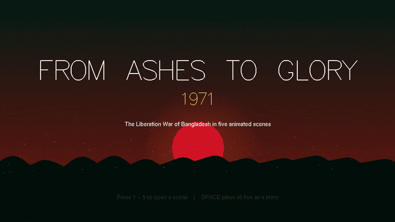
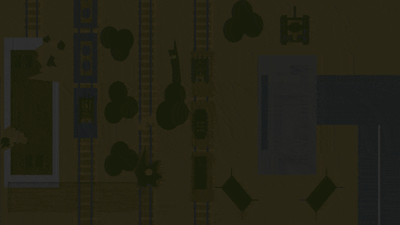
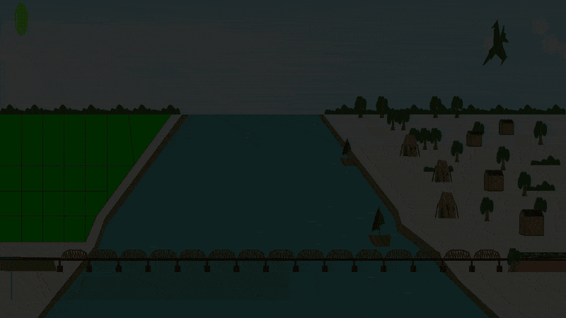
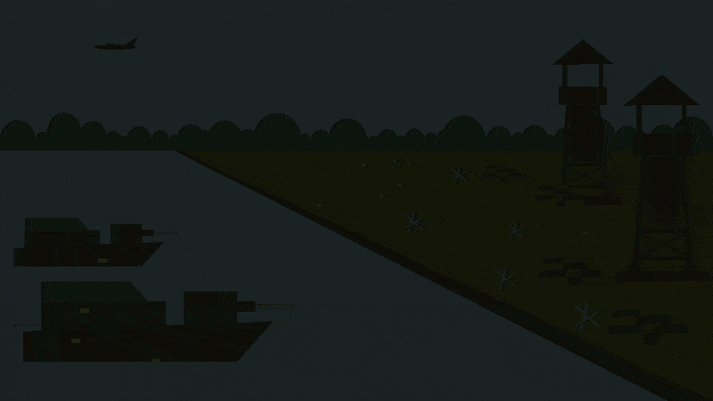
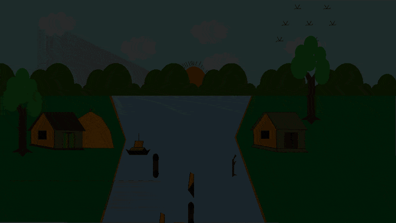
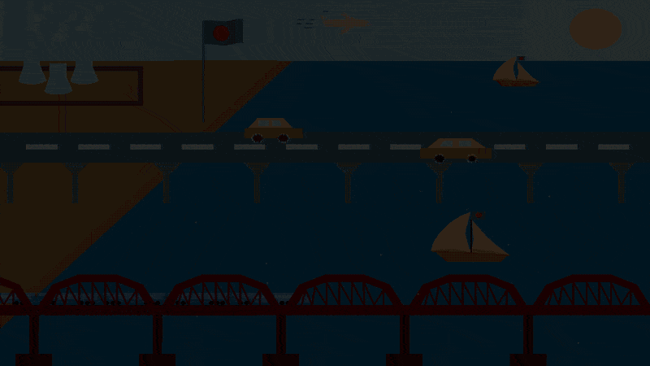

#  From Ashes to Glory: 1971

**A Computer Graphics Project Depicting the Liberation War of Bangladesh**

<p align="center">
  
</p>

##  Project Overview
"From Ashes to Glory: 1971" is a **computer graphics** project that visually narrates the **Bangladesh Liberation War of 1971**. Through five meticulously designed scenarios, this project **captures the struggle, devastation, and ultimate victory** of Bangladesh.

The story moves from a railway station under occupation, to the bombing of the Hardinge Bridge, to gunboats shelling the coast, to a countryside in ruins, and finally to a modern Bangladesh lit up on Victory Day. Every scene is drawn by hand with OpenGL primitives (polygons, lines, points and circles) and animated with GLUT timers.

##  Scenarios Depicted

### 1️⃣ War-Torn Railway Station

<p align="center">
  
</p>

A Pakistani train moves through a heavily damaged railway station, symbolizing the unrest. The yard is seen from above: trains and tanks roll along the tracks while the station buildings lie in ruins.

What moves in this scene:

- **Burning ruins:** the four broken buildings flicker with fire, throw off embers and send smoke drifting across the yard.
- **Tank fire:** the tank at the top fires every few seconds with a muzzle flash, a puff of smoke and a small camera shake.
- **Rocket launcher:** the missile leaves a glowing exhaust and a smoke trail as it flies.
- **Drifting sand** blows across the yard.
- **Night (L):** the scene darkens and a searchlight sweeps the yard from the station.
- **Rain (M):** the sky clouds over, rain streaks fall across the whole yard and lightning flashes now and then.

The GIF starts in daylight, then switches to a rainy night.

### 2️⃣ Hardinge Bridge Explosion

<p align="center">
  
</p>

A train crosses the historic Hardinge Bridge, which Bangladeshi freedom fighters **blow up** to disrupt enemy supply lines.

What moves in this scene:

- **The attack plays out on its own:** clouds, boats and the train start moving as soon as the scene opens, and the fighter jet flies in after about a second.
- **Jet and bomb:** the jet leaves an afterburner glow and a vapour trail; the falling bomb trails smoke.
- **The explosion:** when the bomb hits, a fireball, sparks and flying debris burst from the span, the screen flashes and shakes, and debris splashes into the river.
- **Aftermath:** the broken span keeps burning and a column of smoke drifts downwind.
- **Living river:** light glints move across the water, sailboats bob on the waves and a flock of birds crosses the sky.
- **Night (I):** stars come out over the river.

### 3️⃣ Coastal Warfare

<p align="center">
  
</p>

Two Pakistani gunboats fire upon a coastal rural area, showing the naval conflicts.

What moves in this scene:

- **Gunboats open fire:** the boats sail in, then take turns firing. Each shot has a muzzle flash, smoke and recoil, and the shell flies in an arc before exploding on the shore.
- **The shore fires back:** freedom fighters on the land answer with tracer fire, and their shots splash into the sea around the boats.
- **Sea and shore:** waves roll toward the land, foam glitters along the shoreline and the boats bob on the water.
- **Waving flags:** the flags on the watchtowers ripple in the wind.
- **Jet:** the jet leaves a vapour trail across the sky.
- **Night (N):** stars appear above the battle.

### 4️⃣ Aftermath of War

<p align="center">
  
</p>

A **devastated Bangladesh**, depicting the destruction left behind by war.

What moves in this scene:

- **Villages still burning:** three columns of smoke rise from beyond the tree line.
- **Falling ash** drifts slowly down over the countryside.
- **The river flows** toward the viewer and the boat bobs as it moves.
- **The sun glows** softly over the horizon, and birds fly overhead.
- **Night (R):** stars come out and fireflies drift along the riverbanks.

### 5️⃣ Modern Bangladesh

<p align="center">
  
</p>

A **rejuvenated, developed** Bangladesh, representing the nation's progress and resilience.

What moves in this scene:

- **The flag of Bangladesh** waves in the wind by the river.
- **Industry and traffic:** steam rises from the power plant's cooling towers, cars drive across the highway and a plane leaves a contrail.
- **Sunlit water:** glints sparkle across the river and the boats bob on the water; birds fly past in the daytime.
- **Victory Day night (T):** street lamps light the highway, cars turn on their headlights, stars fill the sky and fireworks burst above the river.

The GIF starts in daylight, then switches to night.

##  Title Screen, Captions and Story Mode

- **Title screen:** the program opens on a title screen with a red sun glowing behind a dark tree line and embers rising into the sky, instead of a blank white window.
- **Scene captions:** each scene fades in with a caption that names it, describes it in one line and lists its keys. The caption fades out after a few seconds.
- **Story mode:** press **Space** to play all five scenes in order, 16 seconds each, with a progress bar at the bottom. Press Space again to stop.
- **Replay:** pressing a scene's number key opens it from the start, so one-off events such as the bridge bombing play again.

##  Keyboard Controls

### Anywhere

| Key | Action |
| --- | --- |
| `1` – `5` | Open scene 1 to 5 (from the start) |
| `Space` | Start or stop story mode (all five scenes in order) |
| `Esc` | Back to the title screen |

### Per scene

| Scene | Keys |
| --- | --- |
| 1. War-Torn Railway Station | `L` night, `K` day, `M` rain |
| 2. Hardinge Bridge Explosion | `A` / `B` clouds start / stop, `C` / `D` boats start / stop, `E` / `F` jet start / stop, `G` / `H` train start / stop, `I` night, `J` day |
| 3. Coastal Warfare | `N` night, `O` day |
| 4. Aftermath of War | `P` / `Q` boat start / stop, `R` night, `S` day |
| 5. Modern Bangladesh | `T` night, `U` day |

Upper- and lower-case letters both work. The original key list is also in [`Keyboard Interaction Instructions.pdf`](Keyboard%20Interaction%20Instructions.pdf). In this merged program, scene 4's `R` switches to night and `S` to day.

##  Build and Run

### Windows (Code::Blocks)

1. Install Code::Blocks with MinGW and set up GLUT (`glut32`) for it.
2. Open `Final Project.cbp`.
3. Build and run. The project links `glut32`, `opengl32`, `glu32`, `winmm` and `gdi32`.

### Linux

```bash
sudo apt install g++ freeglut3-dev
g++ -O2 main.cpp -o fromashes -lGL -lGLU -lglut -lm
./fromashes
```

##  Project Structure

```
.
├── main.cpp                                # All five scenes, the effects, title screen and controls
├── Final Project.cbp                       # Code::Blocks project
├── Keyboard Interaction Instructions.pdf   # Original keyboard guide
└── title.gif, scene1.gif … scene5.gif      # Animated previews used in this README
```

## 🛠 Technologies Used
- **C++ & OpenGL** – For rendering 2D/3D graphics.
- **GLUT** – For handling windowing and user interactions.
